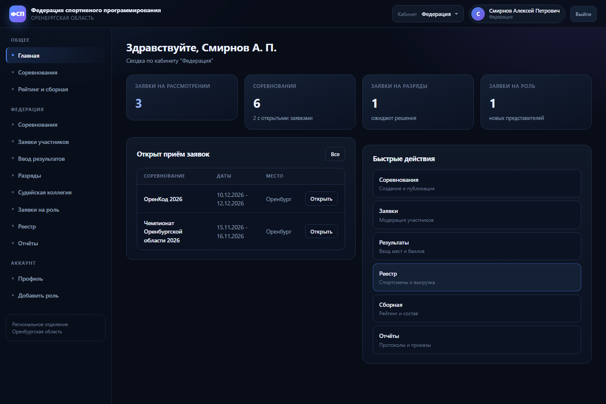
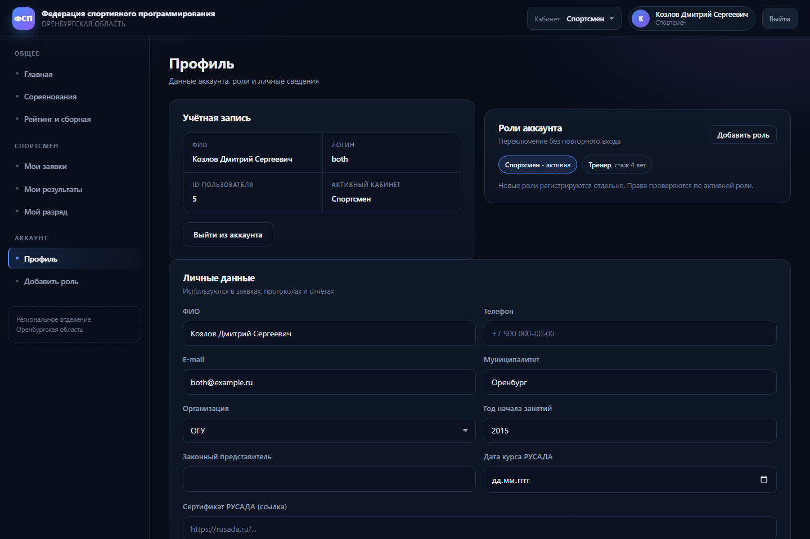
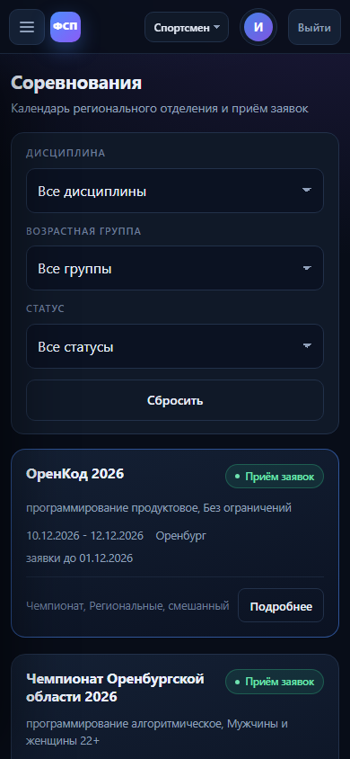
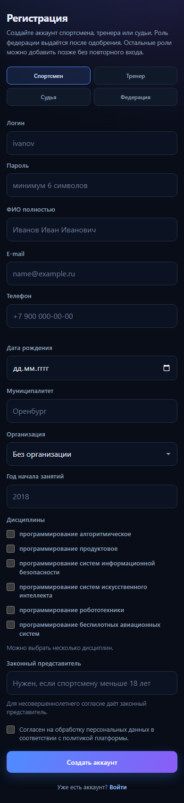
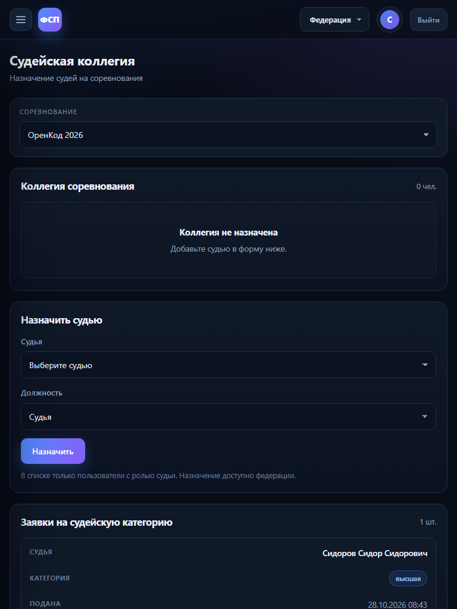
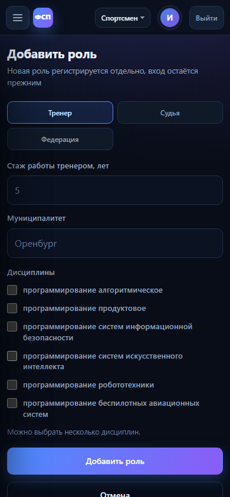
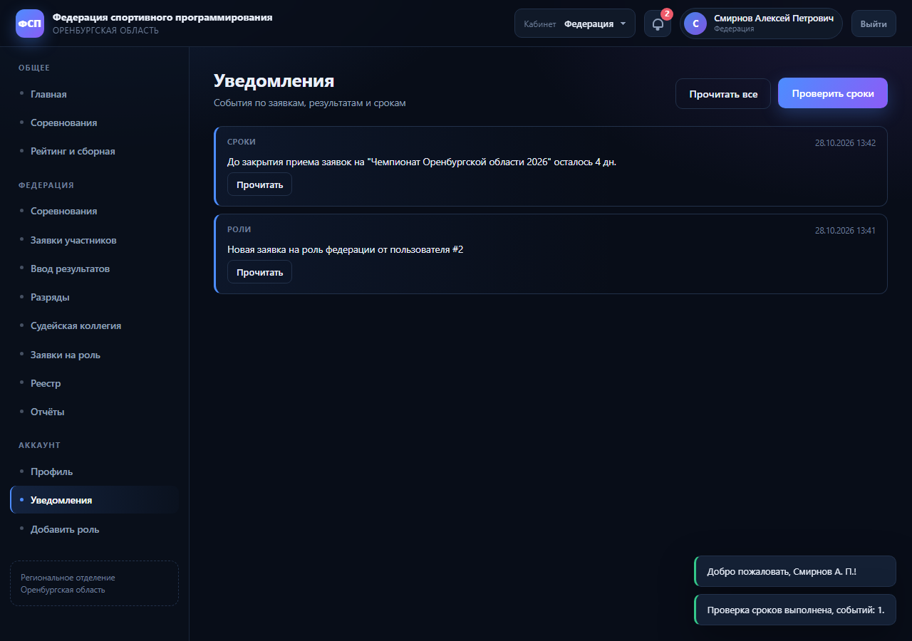
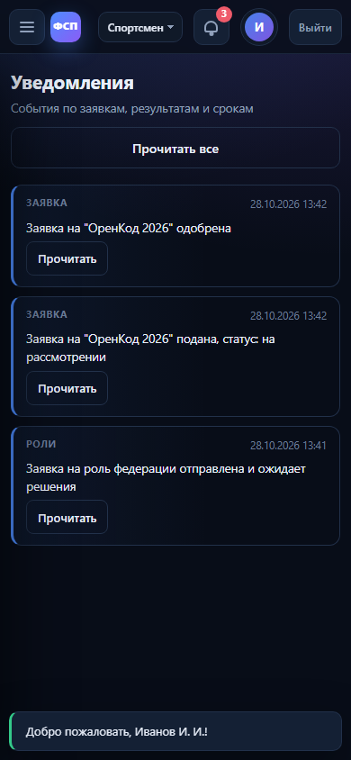

# Единая цифровая платформа ФСП Оренбургской области

Демо-версия платформы регионального отделения Федерации спортивного программирования (кейс "ОренКод 2026").

Платформа ведёт учёт спортсменов, тренеров, судей и организаций, календарь соревнований и заявки, результаты и протоколы, разряды и судейские категории, реестр занимающихся с отчётом о численности, рейтинг и сборную региона.

Все персональные данные в демо-версии вымышлены.

## Скриншоты

| Кабинет федерации | Роли одного аккаунта |
|---|---|
|  |  |

| Соревнования на телефоне | Регистрация на телефоне |
|---|---|
|  |  |

| Судейская коллегия на планшете | Добавление роли на телефоне |
|---|---|
|  |  |

| Уведомления | Уведомления на телефоне |
|---|---|
|  |  |

## Возможности

- Личные кабинеты федерации, спортсмена, тренера и судьи.
- Несколько ролей у одного аккаунта: роли хранятся в отдельной таблице, добавляются по одной и переключаются без повторного входа.
- Календарь соревнований: создание, публикация, приём заявок, модерация, протокол.
- Заявки на разряды и судейские категории, контроль сроков действия.
- Рейтинг спортсменов и формирование сборной, проект приказа.
- Реестр спортсменов и отчёт о численности в `.xlsx`.
- Документы в `.docx`: протокол, отчёт по спортсмену, список сборной.
- Проверка полей по регулярным выражениям на клиенте и на сервере.
- Адаптивная вёрстка для компьютера, планшета и телефона.
- Уведомления в личном кабинете и внешний канал: файл logs/emails.log.
- Загрузка положений соревнований в PDF и DOCX, скачивание участниками.
- Ежедневная проверка сроков разрядов, категорий и приёма заявок.

## Требования

- Node.js 20 или новее
- npm

## Быстрый старт

```bash
npm install
cp .env.example .env
npm run dev
```

На Windows файл окружения копируется так:

```powershell
copy .env.example .env
```

После запуска откройте `http://localhost:3000`. Фронтенд раздаётся тем же сервером из папки `public`, отдельная сборка не нужна.

Для запуска без nodemon:

```bash
npm start
```

Переменные окружения (`.env`):

| Переменная | Значение по умолчанию | Назначение |
|---|---|---|
| PORT | 3000 | порт сервера |
| JWT_SECRET | - | секрет для подписи токенов, задайте свой |
| DB_PATH | ./db.sqlite | путь к файлу SQLite |
| NODE_ENV | development | в dev включает CORS |

База создаётся при первом запуске и сразу заполняется демо-данными. Чтобы начать заново, удалите `db.sqlite` (и файлы `db.sqlite-wal`, `db.sqlite-shm`) и перезапустите сервер.

## Демо-доступы

Пароль у всех аккаунтов: `123`.

| Логин | Роли |
|---|---|
| `fed` | федерация |
| `athlete` | спортсмен |
| `coach` | тренер |
| `judge` | судья |
| `both` | спортсмен + тренер |
| `fedreq` | заявка на роль федерации на рассмотрении |

## Мультироль

Один аккаунт может иметь до четырёх ролей. Каждая роль регистрируется отдельно:

1. Пользователь создаёт аккаунт с одной ролью (спортсмен, тренер, судья или заявка на федерацию).
2. В профиле нажимает "Добавить роль" и заполняет поля новой роли.
3. Сервер проверяет обязательные поля именно этой роли и добавляет запись в `user_roles`.
4. В верхней панели появляется переключатель кабинетов. Переключение не требует повторного входа.

Права проверяются по активной роли из заголовка `X-Role`. Если роли у аккаунта нет, сервер вернёт 403.

Обязательные поля ролей:

| Роль | Обязательные поля |
|---|---|
| спортсмен | дата рождения, муниципалитет, хотя бы одна дисциплина; для несовершеннолетнего - законный представитель |
| тренер | стаж работы тренером, хотя бы одна дисциплина |
| судья | судейская категория |
| федерация | дополнительных полей нет, создаётся заявка на одобрение |

Роли хранятся в таблице `user_roles` (связь многие-ко-многим), справочник ролей - в таблице `roles`. Старое поле `users.roles` осталось строкой-кэшем, при старте данные из него переносятся автоматически.

API: `POST /api/auth/roles`, `GET /api/auth/me`, `GET /api/auth/profile`, `PATCH /api/auth/profile`. Подробнее в `docs/api.md`.

## Проверка полей

Регулярные выражения вынесены в два модуля с одинаковыми правилами:

- `validation.js` - сервер;
- `public/js/validate.js` - клиент.

Проверяются логин, пароль, ФИО, e-mail, российский телефон, дата рождения, год, стаж, место, баллы, номер приказа, ссылки и причины отказа. Ошибка показывается под полем, поле подсвечивается, форма не отправляется.

Пример ответа сервера:

```json
{
  "error": {
    "code": "VALIDATION_ERROR",
    "message": "проверьте заполнение полей",
    "fields": {
      "phone": "Телефон: +7 900 000-00-00",
      "birthDate": "Дата рождения не может быть в будущем"
    }
  }
}
```

Полная таблица правил - в `docs/api.md`, раздел "Проверка полей".

## Адаптивность

- До 768 px: боковое меню убирается под кнопку, таблицы превращаются в карточки с подписями, фильтры и формы перестраиваются в одну колонку.
- До 480 px: уменьшены отступы, кнопки не меньше 46 px, поля получают размер шрифта 16 px (чтобы телефон не масштабировал страницу), модальные окна открываются снизу.
- Горизонтальной прокрутки страницы нет; широкие таблицы на компьютере прокручиваются внутри своего блока.

Проверить можно в инструментах разработчика на ширинах 1440, 768 и 390 px.

## Уведомления и контроль сроков

Уведомления создаются при смене статуса заявки, внесении результата, публикации протокола,
заявке на разряд или судейскую категорию, назначении судьи, привязке тренера и одобрении роли.

- В кабинете: колокольчик в шапке со счетчиком и страница "Уведомления".
- Внешний канал: файл logs/emails.log. В продакшене вместо файла подключается почтовый сервис,
  интерфейс notify() не меняется.
- Cron запускается ежедневно в 9:00 и проверяет разряды, категории и дедлайны заявок.
- Федерация может запустить проверку вручную кнопкой "Проверить сроки" на странице уведомлений.

## Положения соревнований

Федерация загружает положение в карточке соревнования: PDF или DOCX, до 10 МБ.
Файл сохраняется в uploads/ под случайным именем, путь пишется в competitions.regulation_path.
Спортсмены и тренеры скачивают положение по ссылке в карточке.
При повторной загрузке старый файл удаляется.

## Безопасность

- Пароли хранятся в виде bcrypt-хеша.
- JWT проверяется на каждом запросе, активная роль сверяется с базой.
- Заголовки безопасности: helmet.
- Ограничение частоты входов и регистраций: express-rate-limit.
- Все запросы к SQLite параметризованные, загрузка файлов ограничена типом и размером.

## Тесты

```bash
npm test
```

Запускается встроенный `node:test`. Тесты лежат в `tests/`:

- `validation.test.js` - регулярные выражения, даты, телефоны, роли и обязательные поля;
- `roles.test.js` - таблица `user_roles`, несколько ролей, дубли, миграция старых ролей;
- `api.test.js` - интеграционные проверки HTTP API на временной базе: регистрация, добавление ролей, права по активной роли, профиль, заявки, результаты, протокол, рейтинг;
- `ageCheck.test.js`, `deadlines.test.js`, `rating.test.js` - возрастные группы, сроки действия и баллы рейтинга;
- `notifications.test.js` - запись уведомлений, дедупликация, внешний лог;
- `guards.test.js`, `auth.test.js` - проверки прав, JWT и bcrypt.

Отдельно только API:

```bash
npm run test:api
```

Тесты API создают временную базу в системной папке и не затрагивают `db.sqlite`.

## Ручные сценарии проверки

1. Войти как `both`, переключить кабинет с "Спортсмен" на "Тренер": меню и разделы меняются, повторный вход не нужен.
2. Зарегистрировать спортсмена, затем добавить роль тренера: без стажа форма не отправляется, после заполнения роль появляется в профиле и в переключателе.
3. Войти как `fed`, создать соревнование, опубликовать его.
4. Войти спортсменом, подать заявку на это соревнование.
5. Вернуться в федерацию, одобрить заявку, закрыть приём заявок.
6. Ввести результат: место 0 или занятое место не принимаются, корректное место сохраняется.
7. Скачать протокол `.docx`, проверить результат в истории спортсмена и в рейтинге.
8. Ввести некорректные e-mail, телефон, ФИО, дату, ссылку и число: ошибки видны у полей, форма не отправляется.
9. Открыть личный кабинет и календарь на ширинах 768 и 390 px: нет горизонтальной прокрутки, кнопки доступны, таблицы читаются.

## Структура

```
server.js            точка входа Express
validation.js        проверка полей для API
ratingPoints.js      баллы рейтинга
auth/                JWT, активная роль, проверки прав
db/                  схема, миграции, роли, демо-данные
routes/              API по доменам
documents/           генерация docx и xlsx
workers/             ежедневная проверка сроков
utils/               работа с датами
tests/               тесты node:test
docs/                описание API и схемы базы
public/              фронтенд: HTML, CSS, JS
  js/notifications.js уведомления и счетчик в шапке
  js/validate.js     правила проверки полей на клиенте
notifications/       запись уведомлений в базу и внешний лог
logs/                logs/emails.log, имитация отправки писем
uploads/             загруженные файлы (в git не попадают)
```

Ключевые файлы:

- `server.js` - подключение роутов, статики, обработка ошибок;
- `db/index.js` - создание таблиц и миграция ролей;
- `db/roles.js` - добавление и чтение ролей;
- `routes/auth.js` - регистрация, вход, роли, профиль;
- `public/js/auth.js` - вход, регистрация, добавление роли, профиль;
- `public/css/style.css` - стили и медиа-запросы.

## Документация

- `docs/api.md` - эндпоинты, ошибки, примеры запросов, правила проверки полей.
- `docs/db.md` - таблицы, связи, кто какие данные читает и пишет.

## Ограничения демо-версии

- Внешний канал уведомлений - файл logs/emails.log, реальная почта не отправляется.
- Персональные данные хранятся в открытом виде в SQLite: AES-шифрование из референсного
  бэкенда не переносилось, чтобы не ломать существующую базу и API.
- Интеграция с Госуслугами и внешними системами не требуется по условиям кейса.
